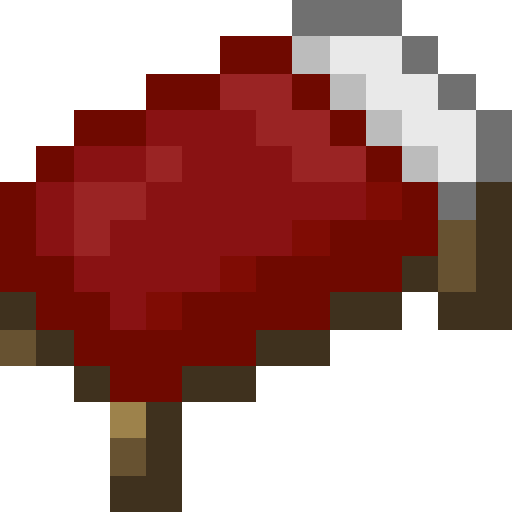

<div align="center">

# 🛏️ BetterBedWars



**A complete BedWars minigame for PocketMine-MP servers.**

Solo, Duos & Squads · Spectator mode · In-game map creation · Shops, upgrades & traps

[](https://github.com/pmmp/PocketMine-MP)
[](changelogs/1.2.0.md)
[](LICENSE)

</div>

---

## 📖 About

BetterBedWars is a PvP minigame where teams must protect their bed from being destroyed by other players. Once a team's bed is destroyed, its members can no longer respawn. The last team standing wins!

> **This project is a fork of [Sergittos/BedWars](https://github.com/Sergittos/BedWars) (BedwarsPM) by [Sergittos](https://github.com/Sergittos)**, maintained and improved under the **BetterLite** name.
> All credit for the original game design, maps and systems goes to the original author. ❤️

## ✨ Features

- 🎮 **Solos, Duos & Squads** — queue through clickable NPCs or the `/bedwars` command
- 👁️ **Spectator mode** — teleporter, player tracking compass, auto-teleport, night vision and flying speed settings
- 🗺️ **In-game map creation** — claim wand, zones, beds, generators, shop villagers, all via forms
- 💰 **Shops & Upgrades** — 7 item categories, team upgrades (Sharpened Swords, Armor Protection, Maniac Miner, Iron Forge, Heal Pool) and 4 traps
- 🛒 **Tracker Shop** — track enemies with your compass in the endgame
- ⚡ **Upgradeable generators** — Iron, Gold, Diamond, Emerald, with tiers and floating text
- 🎉 **Game events** — generator tier upgrades, bed destruction, tie endgame
- 📂 **3 storage providers** — SQLite3, MySQL (async) and JSON
- 🌟 **And more!**

### What this fork adds
- ✅ **20+ bug fixes** (crashes on quit, map creation, MySQL loading, traps, TNT, tracking and more)
- ✅ **All original TODOs completed** — final kills, trap sounds, `Mode`/`ShopId` enums, deduplicated code
- See the full list in the [changelog](changelogs/1.2.0.md).

## 📥 Installation

1. Download the latest `.phar` from the [releases](https://github.com/BetterLite/BetterBedWars/releases) page.
2. Drop it into your server's `plugins/` folder.
3. Restart the server.
4. Run `/bedwars` in-game to create and manage your maps, and `/bedwars` (or an NPC) to join a game.

> Use the compiled `.phar` as the production installation. If you run the source folder directly, run `composer install` first so its dependencies are available.

> 📺 Watch a [map creation tutorial](https://youtu.be/BdP5b9C4yqA) from the original project.

## 🕹️ Commands

| Command | Description | Permission |
|---|---|---|
| `/bedwars` | Open the BedWars menu (create maps, manage maps, spawn the join NPC) | `pocketmine.group.operator` |

## ⚙️ Configuration

`plugin_data/BetterBedWars/config.yml`:

```yaml
# The version
version: 1.0

# The IP shown on the scoreboard and the bossbar
ip: "play.server.net"

# Players won't be able to break/place blocks or receive damage on the lobby if this is enabled
spawn-protection: true

# Provider
# Available providers: sqlite, mysql, json
provider: "sqlite"

# MySQL
mysql-credentials:
  hostname: "127.0.0.1"
  username: "root"
  password: ""
  database: "bedwars"
  port: 3306
```

## 🛠️ Building from source

```bash
git clone https://github.com/BetterLite/BetterBedWars.git
cd BetterBedWars
composer install
composer build   # produces BetterBedWars.phar via Pharynx
```

> The build depends on the [BetterLite](https://github.com/orgs/BetterLite/repositories) server packages (`betterlite/pocketmine-mp`) and embeds bStats + EasyUI into the phar through Pharynx.

## 📚 Libraries Used

- [EasyUI](https://github.com/dresnite/easyui) by **dresnite**
- [bStats](https://github.com/Bastian/bstats-pmmp) by **Bastian**
- [Pharynx](https://github.com/SOF3/pharynx) by **SOF3** (build tooling)

## 📄 License

This project is licensed under the **GNU Lesser General Public License v3.0** (inherited from the original project). See the [LICENSE](LICENSE) file for details.

## 🙏 Credits

- **Original project:** [Sergittos/BedWars](https://github.com/Sergittos/BedWars) by [Sergittos](https://github.com/Sergittos)
- **Fork & maintenance:** BetterLite
